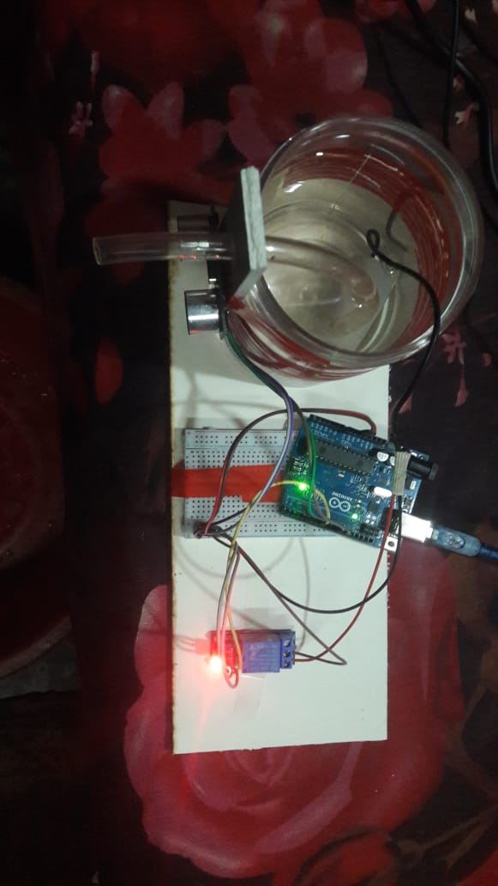
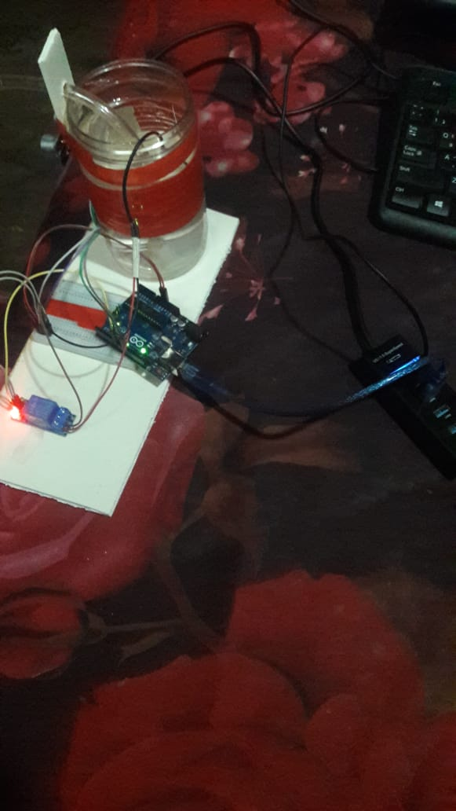
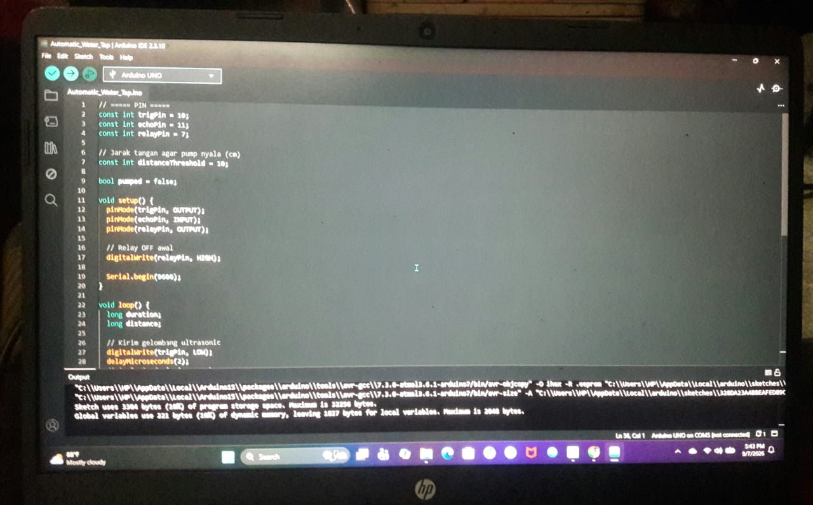

# 🚰 Automatic Water Tap using Arduino UNO

An automatic water tap system built using **Arduino UNO, HC-SR04 Ultrasonic Sensor, Relay Module, and DC Water Pump**.

The system detects a hand or glass placed near the ultrasonic sensor and automatically turns ON the water pump for **0.5 seconds**. After dispensing water, the system waits until the object is removed before allowing the next activation.

---

## 📌 Project Overview

This project is designed to provide automatic water dispensing without manually operating a tap.

The **HC-SR04 ultrasonic sensor** measures the distance between the sensor and the user's hand or glass. When the detected distance is **10 cm or less**, the Arduino activates the relay, which powers the DC water pump.

### Main Features

- 🤖 Automatic water dispensing
- 📡 HC-SR04 ultrasonic distance detection
- 💧 DC water pump control
- 🔌 Relay-based pump switching
- ⏱️ Pump runs for 0.5 seconds
- 🔄 Prevents continuous pumping while the object remains near the sensor
- 🖥️ Distance and pump status displayed through Serial Monitor

---

## 🧰 Components Required

| Component | Quantity |
|---|---:|
| Arduino UNO | 1 |
| HC-SR04 Ultrasonic Sensor | 1 |
| Relay Module | 1 |
| DC Water Pump (5V/12V) | 1 |
| External Power Supply for Pump | 1 |
| Water Container | 1 |
| Water Tube/Pipe | 1 |
| Breadboard | 1 |
| Jumper Wires | As required |

---

## 🔌 Pin Configuration

### HC-SR04 Ultrasonic Sensor

| HC-SR04 Pin | Arduino UNO |
|---|---|
| VCC | 5V |
| TRIG | D10 |
| ECHO | D11 |
| GND | GND |

### Relay Module

| Relay Pin | Connection |
|---|---|
| IN | Arduino D7 |
| VCC | Arduino 5V |
| GND | Arduino GND |
| COM | External pump supply + |
| NO | Pump + |
| NC | Not used |

### Water Pump

| Pump Wire | Connection |
|---|---|
| Pump + | Relay NO |
| Pump − | External power supply − |

> ⚠️ **Important:** The water pump should be powered from an appropriate external power supply. Do not power a high-current pump directly from the Arduino 5V pin.

---

## ⚙️ Working Principle

The system operates according to the following sequence:

```text
        Start
          │
          ▼
   HC-SR04 Measures
      Distance
          │
          ▼
   Distance ≤ 10 cm?
       /       \
     Yes        No
      │          │
      ▼          ▼
 Pump ON       Pump OFF
      │
      ▼
 0.5 Second
      │
      ▼
 Pump OFF
      │
      ▼
 Wait Until Object
     Is Removed
      │
      └──────────────► Repeat
```

### How it works

1. The HC-SR04 sensor continuously measures the distance.
2. If the measured distance is **10 cm or less**, the Arduino detects the object.
3. The relay is activated.
4. The water pump runs for **0.5 seconds**.
5. The relay is turned OFF.
6. The system sets a flag so the pump does not continuously restart while the object remains in front of the sensor.
7. When the object is removed, the system resets and becomes ready for the next detection.

---

## 💻 Arduino Code

```cpp
// ===== PIN =====
const int trigPin = 10;
const int echoPin = 11;
const int relayPin = 7;

// Jarak tangan agar pump nyala (cm)
const int distanceThreshold = 10;

bool pumped = false;

void setup() {
  pinMode(trigPin, OUTPUT);
  pinMode(echoPin, INPUT);
  pinMode(relayPin, OUTPUT);

  // Relay OFF awal
  digitalWrite(relayPin, HIGH);

  Serial.begin(9600);
}

void loop() {

  long duration;
  long distance;

  // Kirim gelombang ultrasonic
  digitalWrite(trigPin, LOW);
  delayMicroseconds(2);

  digitalWrite(trigPin, HIGH);
  delayMicroseconds(10);

  digitalWrite(trigPin, LOW);

  // Baca pantulan dengan timeout 30ms
  duration = pulseIn(echoPin, HIGH, 30000);

  // Ubah jadi cm
  distance = duration * 0.034 / 2;

  Serial.print("Distance: ");
  Serial.print(distance);
  Serial.println(" cm");

  // Gelas/tangan detected
  // distance = 0 OR distance <= 10 cm
  if (distance == 0 || 
      (distance > 0 && distance <= distanceThreshold)) {

    if (!pumped) {

      Serial.println("Pump ON");

      digitalWrite(relayPin, LOW);   // Pump ON

      delay(500);                    // Pump for 0.5 second

      digitalWrite(relayPin, HIGH);  // Pump OFF

      pumped = true;
    }

  } else {

    Serial.println("Pump OFF");

    pumped = false; // Reset when object is removed
  }

  delay(200);
}
```

---

## 🧠 Important Code Parameters

### Detection Distance

```cpp
const int distanceThreshold = 10;
```

The pump is activated when the detected distance is **10 cm or less**.

You can change this value according to the physical position of the sensor.

### Pump Duration

```cpp
delay(500);
```

The value is in milliseconds.

```text
500 ms = 0.5 second
```

Therefore, the pump runs for approximately **0.5 seconds** after detection.

---

## 🔄 Relay Logic

The relay module used in this project is configured as **Active LOW**.

```cpp
digitalWrite(relayPin, LOW);
```

means:

```text
Relay ON → Pump ON
```

and:

```cpp
digitalWrite(relayPin, HIGH);
```

means:

```text
Relay OFF → Pump OFF
```

---

## 📊 Serial Monitor

The Arduino sends the measured distance to the Serial Monitor at:

```text
9600 baud
```

Example:

```text
Distance: 18 cm
Pump OFF

Distance: 9 cm
Pump ON

Distance: 17 cm
Pump OFF
```

---

## 📷 Project Setup

The physical prototype consists of:

- Arduino UNO
- HC-SR04 ultrasonic sensor
- Relay module
- DC water pump
- Water container
- Water pipe
- Breadboard
- External pump power supply

The ultrasonic sensor is positioned near the water outlet so that placing a hand or glass near the sensor triggers automatic water dispensing.

---

## 🔧 Connection Diagram

```text
HC-SR04
   │
   ├── TRIG ───── Arduino D10
   ├── ECHO ───── Arduino D11
   ├── VCC ────── Arduino 5V
   └── GND ────── Arduino GND

Arduino D7
   │
   ▼
Relay Module
   │
   ├── COM ───── External Supply +
   │
   └── NO ────── Pump +

External Supply −
   │
   └──────────── Pump −
```

---

## ⚠️ Safety Notes

- Do not connect a high-current water pump directly to an Arduino GPIO pin.
- Use a suitable relay module to control the pump.
- Use an appropriate external power supply for the pump.
- Keep water away from the Arduino, breadboard, USB connection, and exposed electrical connections.
- Make sure all electrical connections are properly insulated.
- Check the pump's rated voltage before connecting the external supply.

---

## 🚀 Future Improvements

Possible improvements include:

- Adjustable water dispensing duration
- Water level monitoring
- OLED/LCD display
- Low-water warning
- Servo-controlled tap mechanism
- Touchless hand detection
- Rechargeable battery operation

---

## 📁 Repository Files

```text
Automatic-Water-Tap/
│
├── Automatic_Water_Tap.ino
├── Connection Diagram.jpg
├── 1.jpeg
├── 2.jpeg
├── 3.jpeg
└── README.md
```

---

## 👨‍💻 Project Information

**Project Name:** Automatic Water Tap  
**Controller:** Arduino UNO  
**Sensor:** HC-SR04 Ultrasonic Sensor  
**Actuator:** DC Water Pump  
**Control:** Relay Module  
**Programming Language:** C/C++ (Arduino)

---

## ⭐ Project Status

**Completed Prototype**

The prototype demonstrates automatic water dispensing based on ultrasonic distance detection.

---

## 📸 Project Images

### Prototype



### Project Setup



### Arduino Code



### Connection Diagram


